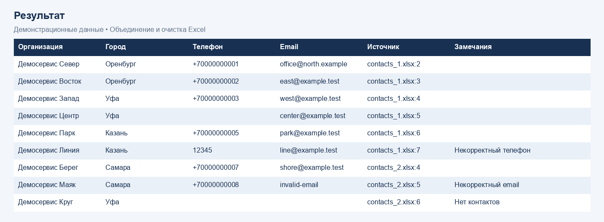
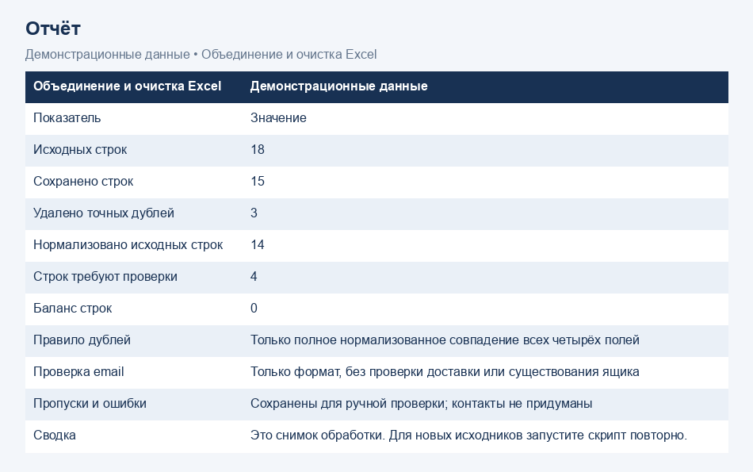

# Объединение и очистка Excel на Python

Демонстрационный проект для портфолио Климентия Хмелевского. Все организации, телефоны и адреса вымышлены. Это новый пример работы, а не выполненный клиентский заказ.

## Задача

Объединить несколько списков контактов, привести формат телефонов и email к единому виду, убрать точные дубли и сохранить проблемные строки для ручной проверки.

## Результат демонстрации

Три файла, 18 исходных строк. Сохранено 15 строк, удалено 3 точных дубля. Четыре строки требуют проверки. Филиал с общим телефоном сохранён отдельно.





## Получить полный проект

Скачайте [excel-cleaning-demo.zip](excel-cleaning-demo.zip) и распакуйте его. Архив содержит исходные Excel-файлы в папке input, результаты в output и изображения. Запускайте команды ниже внутри распакованной папки excel-cleaning-demo. Файлы в корне репозитория также доступны для просмотра кода.

## Запуск

Требуется Python 3.9 или новее.

```text
python -m venv .venv
.venv\Scripts\python -m pip install -r requirements.txt
.venv\Scripts\python clean_excel.py
```

Другие папки:

```text
python clean_excel.py --input path/to/source --output path/to/result
python -m unittest -v
```

На Linux/macOS для виртуального окружения используется `.venv/bin/python`.

## Вход и выход

В папке `input` лежат три XLSX-файла. В первой строке активного листа каждого файла должны быть уникальные колонки `Организация`, `Город`, `Телефон`, `Email`. Пустые строки пропускаются. Лишние столбцы не переносятся; несколько листов не объединяются. Формулы из исходников не вычисляются.

Скрипт создаёт:

- `output/cleaned.xlsx`: отчёт, результат, журнал удалённых дублей и копия исходных значений с указанием файла и номера строки.
- `output/cleaned.csv`: результат в UTF-8 с BOM, разделитель `;`.
- `output/report.json`: показатели обработки.

Исходные файлы не меняются. Повторный запуск перезаписывает результаты в выбранной выходной папке. Выходная папка не может совпадать с исходной или находиться внутри неё.

## Правила и ограничения

Телефон приводится к виду `+7XXXXXXXXXX`, если содержит 10 цифр или 11 цифр с начальной 7/8. Это правило для российских номеров: оно проверяет структуру, но не существование номера. В демонстрации используются заведомо вымышленные номера.

Email переводится в нижний регистр и проверяется по базовому формату. Доставка, DNS и существование ящика не проверяются. Пробелы внутри email не исправляются догадкой.

Дубль удаляется только при полном совпадении четырёх нормализованных полей без ошибок. Совпадения только по телефону или email не удаляются: контакт может принадлежать сети или нескольким филиалам. Строки с пропусками и ошибками сохраняются с замечанием. Отсутствующие контакты не придумываются.

Текст, который мог бы стать формулой Excel/CSV, экранируется апострофом. В исходном архивном листе сохраняется безопасное представление значений. Сводка является снимком обработки; после изменения исходников нужен повторный запуск.

## Моя роль

Разработка логики обработки, проверки качества данных, выгрузки Excel/CSV и автоматических проверок. Проект показывает подход к небольшим задачам автоматизации таблиц.

